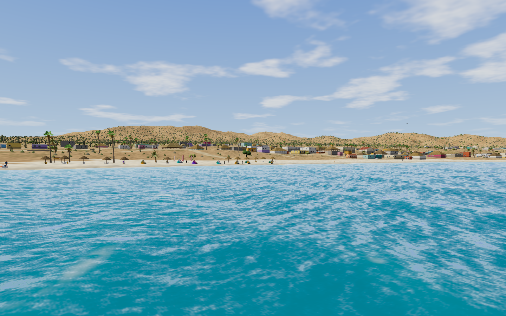
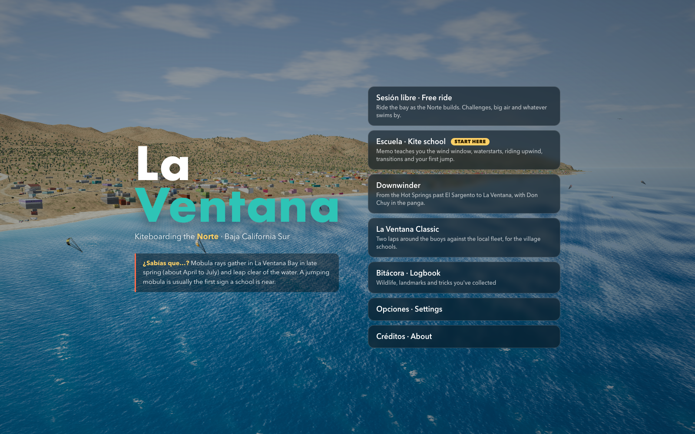
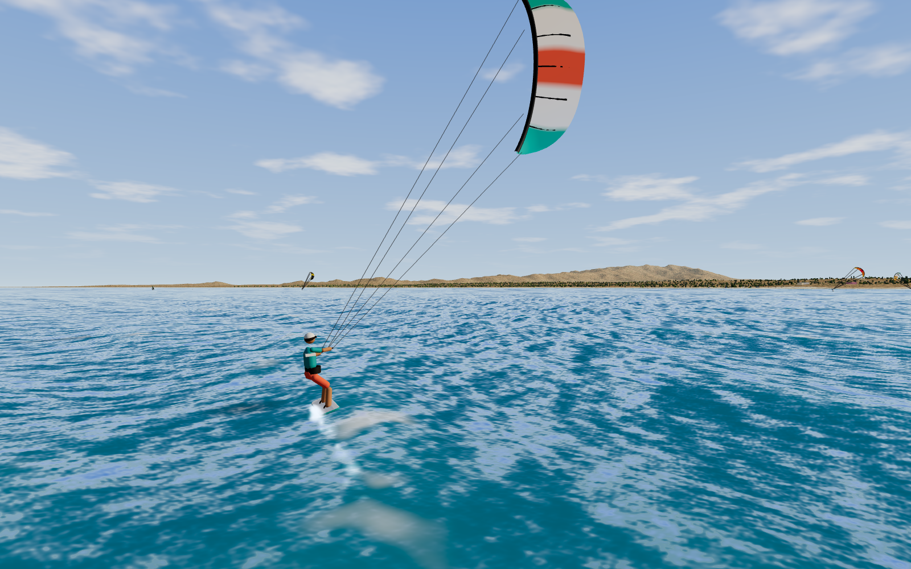
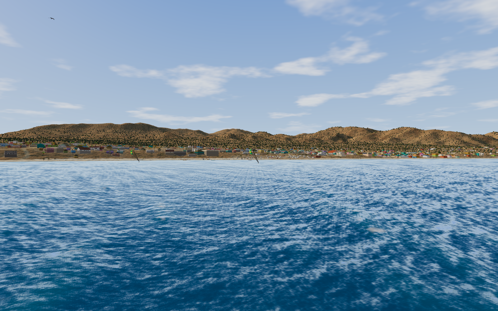
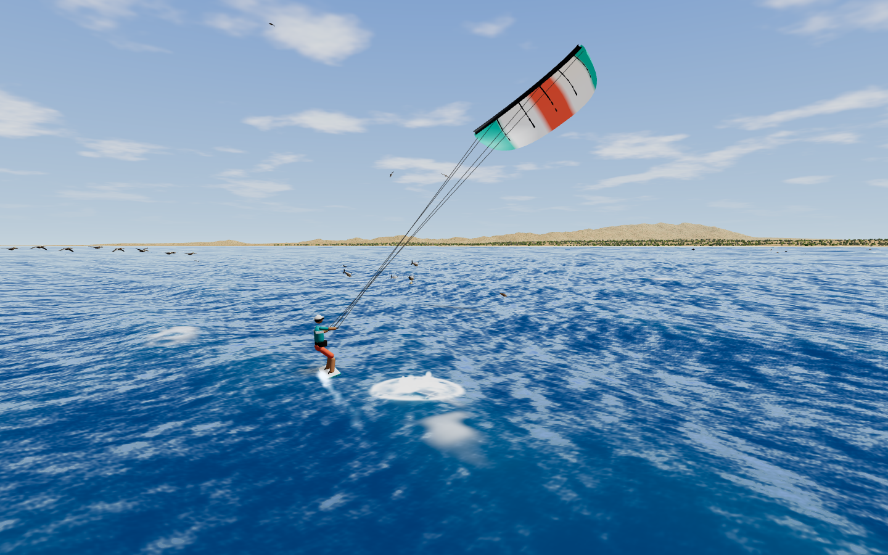
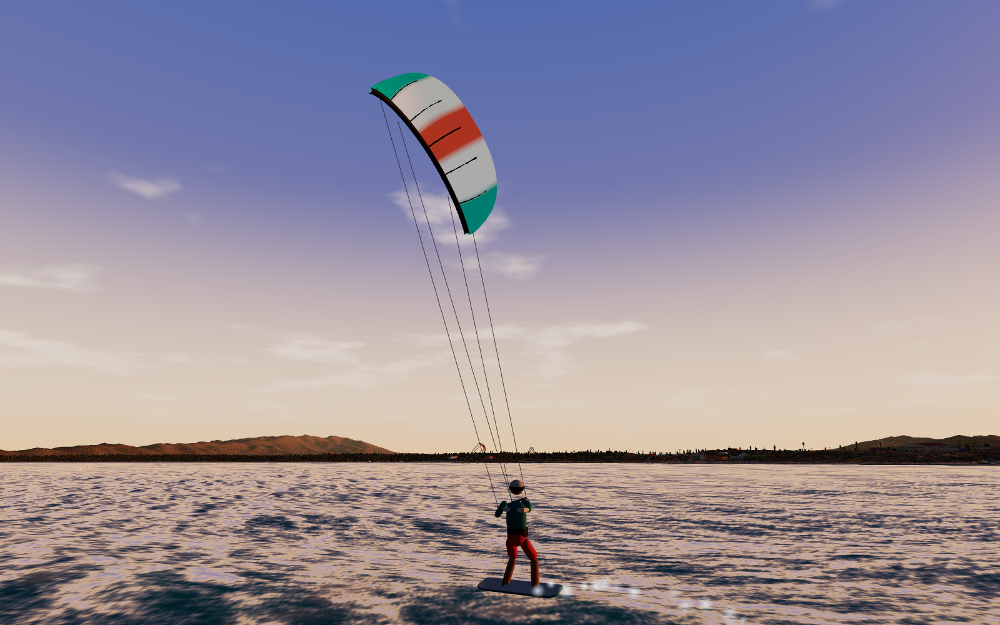

# La Ventana · Kite Session

**▶ Play it: https://steveoscar.github.io/la-ventana-kite/** (desktop browser with a keyboard, tested in Chrome; a gamepad works too)

A kiteboarding game set in La Ventana and El Sargento, Baja California Sur, on the Sea of Cortez. You ride the winter *Norte* on a bay built from real elevation and OpenStreetMap data, with Isla Cerralvo across the channel.



## Run it

```sh
npm install
npm run play       # builds and serves http://127.0.0.1:4188
npm run dev        # dev server with hot reload, http://127.0.0.1:5188
```

`npm run build` writes a static site to `dist/`. Every push to `main` redeploys GitHub Pages (`.github/workflows/deploy.yml`).

## Modes

- **Sesión libre · Free ride**: ride the bay as the wind builds through the afternoon. Work through the challenges, go big, spot wildlife. The session ends at sunset.
- **Escuela · Kite school**: Memo, a local instructor, teaches the wind window, waterstarts, riding upwind, transitions and your first jump.
- **Downwinder**: from the Hot Springs beach past El Sargento to La Ventana, through five gates, with Don Chuy following in his panga.
- **La Ventana Classic**: two laps of an upwind/downwind course against five local racers. It's an homage to the real festival that raises money for the village schools.

## Controls

| | Assisted (default) | Pro |
|---|---|---|
| Carve / turn | A / D (or ← →) | A / D |
| Kite | W more power (dives to waterstart), S depower | ← → steer the bar, ↑ ↓ sheet in/out |
| Jump | hold Space to load the edge and send the kite, release to pop | same |
| In the air | W / S front/back roll, A / D spin, Shift grab, K kiteloop | same |
| Other | R relaunch a downed kite, C camera, M map, F photo mode, H help, V hide HUD, Esc pause, drag the mouse to look around | |

Gamepads work too: left stick carves, A jumps, X grabs, Y kiteloops, B relaunches.

## How it works

- **Physics** (`src/sim`): the kite flies on the surface of a sphere of 22 m lines inside the *wind window*. Its speed and line tension come from the apparent wind and from how deep in the window it is. The board planes, edges against the pull (with induced drag that limits upwind angle to about 45° off the wind) and carves. Jumps come from popping off a loaded edge while the kite sweeps up through the window, and the kite's lift keeps you floating. In Assisted mode an autopilot flies the kite like a competent rider: it parks it for the waterstart, dives it, holds it at about 35°, takes it over the top for transitions, and sends and redirects it for jumps. `node tools/simcheck.ts 19 9` prints calibration numbers.
- **Wind** (`src/world/wind.ts`): the Norte blows from about NNE, builds through the day (thermal boost) and fades at sunset. Gusts drift downwind as darker patches you can see on the water. It's lighter right at the beach and stronger out in the Cerralvo channel.
- **World**: terrain and Cerralvo come from AWS Terrain Tiles. SRTM has no bathymetry here, so the turquoise shelf and seabed are built from the distance to the OSM coastline (`tools/build-terrain.mjs`). Houses come from about 1,970 real OSM building footprints. The sun position is computed for the date and BCS time (UTC−7).

- **The villages** (`src/world/village*`): about 1,760 houses built on real OpenStreetMap footprints. They have flat roofs with tinacos and rebar, palapa roofs, and painted shop fronts such as ABARROTES and TACOS DOÑA LUPE. There's also a chapel in El Sargento, pangas on the beach and at anchor, beach palapas, parked kites, kite-school banners, people and beach dogs, the campground's RVs and tents, concrete power poles, fan and date palms, and the hot-spring pools.
- **The desert** (`src/world/vegetation*`): cardón, pitaya dulce and agria, cholla, palo verde, mesquite, torote, palo adán and scrub, placed by slope, arroyos and settlement, with level of detail out to the far hills.
- **Wildlife** (`src/world/wildlife*`): brown pelicans in lines and plunge-diving, frigatebirds, gulls, an osprey, dolphins that ride alongside, humpback whales (December–April), sea lions, turtles, and leaping mobula rays in April. Each first sighting goes into your logbook.
- **Sound** (`src/audio`): procedural wind, kite roar and flutter, board hiss and chop, shore waves and gulls. The menu plays an original son-style guitar piece in 6/8.

## Screenshots

| | |
|---|---|
|  |  |
|  |  |
|  |  |

## Data and credits

- Elevation: Mapzen / AWS Terrain Tiles (SRTM, GMTED, ETOPO1).
- Coastline, roads and buildings: © OpenStreetMap contributors, ODbL.
- Characters (Memo, Don Chuy, Doña Lupe, Rafa) are fictional. Places, wind, wildlife seasons and food are real.

Regenerating the data: `node tools/fetch-dem.mjs && node tools/fetch-osm.mjs && node tools/build-terrain.mjs`.
